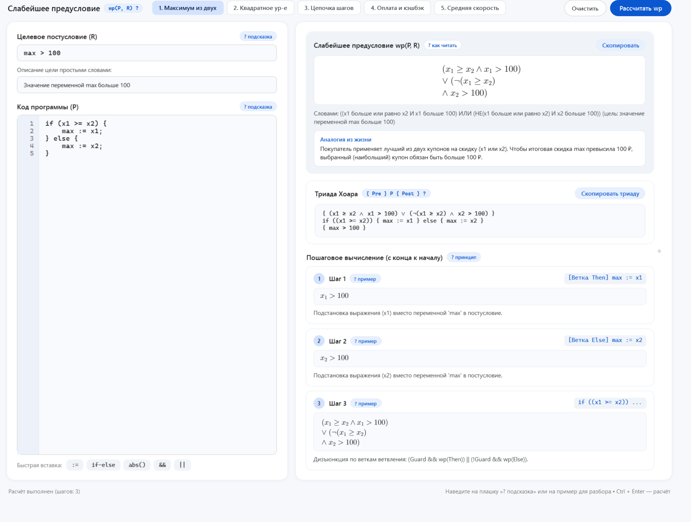
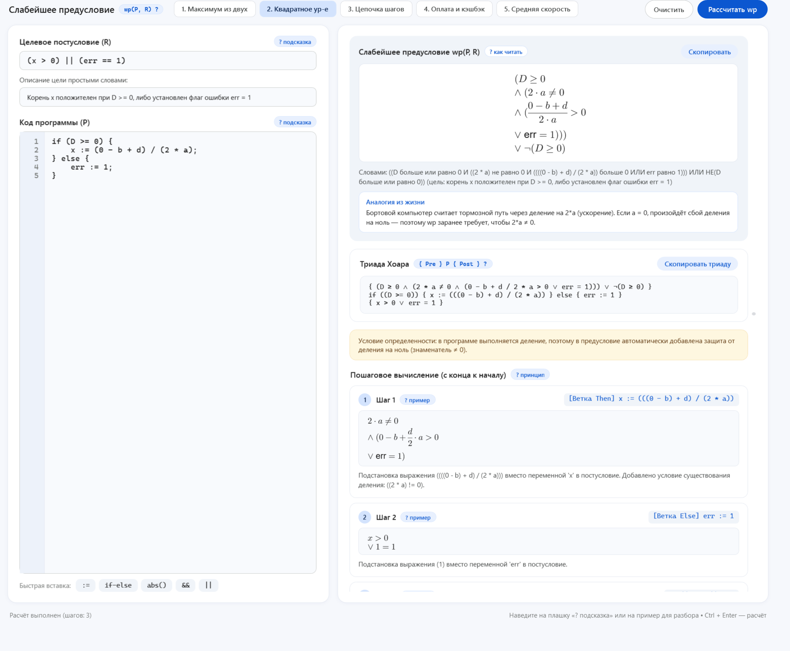
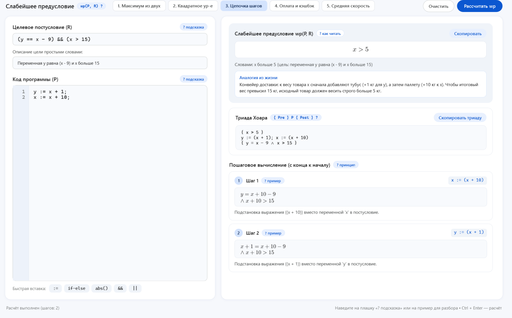
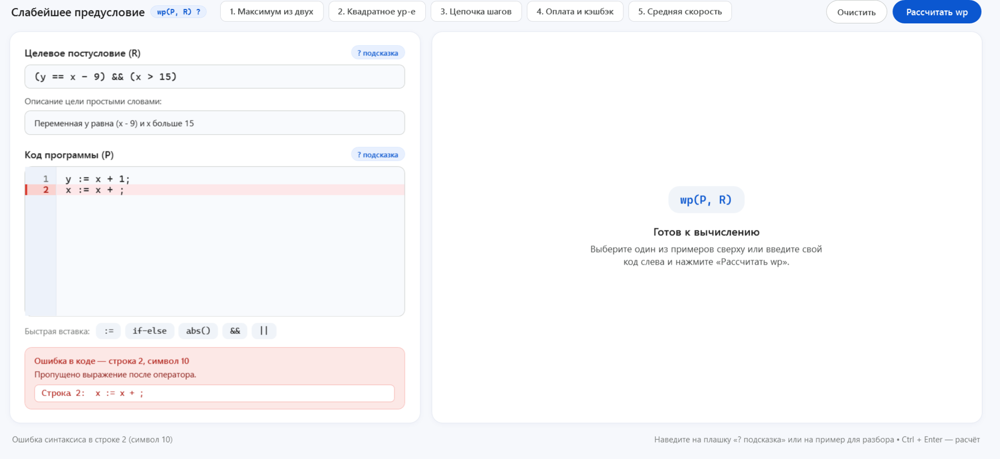

# Движок расчёта слабейшего предусловия (wp) для последовательности и ветвлений

Учебный научно-практический проект по дисциплине «Технологии разработки программного обеспечения»  
**ТвГТУ, группа Б.ПИН.ИИ.25.16**

| Параметр | Спецификация |
| :--- | :--- |
| **Версия проекта** | `v1.0.0` (Лабораторная работа №2) |
| **Язык программирования** | C# 12.0 (Nullable Reference Types, Records, Pattern Matching) |
| **Целевая платформа** | .NET 8.0 LTS (`net8.0`, `net8.0-windows`) |
| **Графическая подсистема** | Windows Presentation Foundation (WPF), `WpfMath` 2.1.0 |
| **Синтаксический анализатор** | Собственный лексер и рекурсивный нисходящий парсер (AST) |
| **Фреймворк тестирования** | xUnit 2.5.3, `Microsoft.NET.Test.Sdk` 17.8.0 |
| **Архитектурный шаблон** | MVVM (Model-View-ViewModel), исчисление предикатов Дейкстры (`wp`) |

---

## Введение

Программный комплекс представляет собой десктопное приложение для автоматизированного символьного расчёта, алгебраического упрощения и пошаговой визуализации слабейшего предусловия (`Weakest Precondition`, `wp`) для программ с последовательностью присваиваний и условными операторами `if-else`. В основу архитектуры положена методология формальной верификации по семантике преобразователей предикатов Э. Дейкстры и логике Хоара, совмещённая с шаблоном `MVVM` и полиграфическим рендерингом математических формул в нотации `LaTeX`.

**Ключевая особенность:** пошаговый обратный вывод и формальная верификация контрактов в графическом интерфейсе:
* **Обратная трассировка (`wp`):** вычисление выполняется снизу вверх (от постусловия к началу программы) с фиксацией каждого промежуточного шага символьной подстановки в коллекции `WpStep`.
* **Контроль области определения (`def`):** перед выполнением подстановки выражений анализатор автоматически находит операции деления и добавляет в предусловие защиту от деления на ноль (`знаменатель != 0`).
* **Алгебраическое упрощение (`Simplifier`):** автоматическая свёртка числовых констант, сокращение тождественных сравнений (`E == E` $\rightarrow$ `true`), перенос слагаемых в линейных неравенствах и устранение нейтральных логических элементов.
* **Спецификация и триада Хоара:** интерактивная панель результатов отображает итоговое предусловие в формате `LaTeX`, перевод логического условия на естественный русский язык (`Humanizer`), полную триаду Хоара `{ Pre } P { Post }` и подсветку строк с синтаксическими ошибками в редакторе кода.

---

## Состав группы

| № | Участник | Роль | Вклад в проект |
| :---: | :--- | :--- | :--- |
| 1 | **Ясенков Никита** | Тимлид, frontend-разработчик | Архитектурный каркас, инфраструктура MVVM (`ViewModelBase`, `RelayCommand`), интерфейс приложения, интеграция рендеринга `WpfMath` и подсветки ошибок |
| 2 | **Иришин Тимофей** | Backend-разработчик | Иерархия узлов абстрактного синтаксического дерева (`Expression`, `Statement`), движок рекурсивной символьной подстановки `SubstitutionEngine` |
| 3 | **Пестов Михаил** | Backend-разработчик | Лексический анализатор `Lexer`, рекурсивный нисходящий парсер `Parser` с диагностикой координат ошибок, генератор текстовых пояснений `Humanizer` |
| 4 | **Воронова Анфиса** | Backend-разработчик | Сервис обратного вывода `WpRunnerService`, извлечение условий определённости при делении, модуль алгебраического упрощения `Simplifier` |
| 5 | **Груздев Андрей** | Аналитик | Формализация правил преобразователя предикатов Дейкстры, составление эталонных сценариев верификации, оформление отчётности |
| 6 | **Кукушкин Андрей** | QA-инженер | Разработка автоматизированного набора модульных тестов на `xUnit`, проверка правил подстановки, парсера и граничных случаев |

---

## Краткая суть операций модуля

| Сценарий | Код программы (`P`) | Постусловие (`R`) | Слабейшее предусловие `wp(P, R)` и пояснение |
| :--- | :--- | :--- | :--- |
| **1. Максимум из двух** | `if (x >= y) then`<br>`  max := x`<br>`else`<br>`  max := y` | `max >= x and max >= y` | `((x >= y) and (x >= y)) or ((x < y) and (y >= x))`<br>Для каждой ветки подставляется своё значение `max`, тождества `x >= x` и `y >= y` сокращаются до `true` |
| **2. Квадратное уравнение** | `d := b * b - 4 * a * c;`<br>`if (d >= 0) then`<br>`  x1 := (-b + sqrt(d)) / (2 * a)`<br>`else`<br>`  x1 := -999` | `x1 != -999` | `(b^2 - 4*a*c >= 0) and (2*a != 0) and ...`<br>Ветка `else` отсекается как ложная (`-999 != -999`), из деления автоматически извлекается защита `2 * a != 0` |
| **3. Цепочка шагов** | `y := x + 1;`<br>`x := x + 10` | `x > 15 and y > 0` | `(x > 5) and (x > -1)`<br>Последовательная подстановка снизу вверх с переносом констант в правую часть неравенств |
| **4. Средняя скорость** | `v := dist / time` | `v >= 60 and dist > 0` | `(time != 0) and (dist / time >= 60) and (dist > 0)`<br>Автоматическое формирование условия безопасности деления `time != 0` перед подстановкой |

> **Пояснение:** вычисление для последовательности операторов выполняется строго с конца программы к началу по правилу композиции `wp(S1; S2, R) = wp(S1, wp(S2, R))`.

---

## Скриншоты интерфейса

### 1. Сценарий «Максимум из двух» (ветвление `if-else`)
Расчёт слабейшего предусловия для условного оператора, рендеринг формулы в `LaTeX`, пошаговый лог трассировки и сборка итоговой триады Хоара:


### 2. Сценарий «Квадратное уравнение» (защита области определения)
Автоматическое обнаружение операции деления в ветке `then`, формирование защитного условия `2 * a != 0` и отсечение невыполнимой ветки `else`:


### 3. Сценарий «Цепочка шагов» (последовательность присваиваний)
Пошаговая обратная подстановка переменных снизу вверх с автоматическим алгебраическим упрощением линейных неравенств:


### 4. Диагностика и локализация синтаксических ошибок
Перехват ошибки разбора с указанием номера строки, визуальной подсветкой некорректной конструкции в редакторе кода и блокировкой расчёта:


---

## Математическое пояснение

Корректность программы относительно спецификации формализована классической триадой Хоара:

```text
{Pre}  P  {Post}
```

* `Pre` (слабейшее предусловие `wp(P, Post)`): минимальное достаточное логическое условие на входные переменные до запуска программы.
* `P` (Program, программа): последовательность присваиваний и условных операторов `if-else`.
* `Post` (постусловие `R`): целевой предикат, который должен быть истинным после завершения `P`.

Базовые правила преобразователя предикатов Э. Дейкстры, реализованные в ядре `WpEngine.Core`:

* **Присваивание (с учётом области определения):**
  ```text
  wp(x := e, R)  =  def(e) ∧ R[x ← e]
  ```
* **Последовательность операторов:**
  ```text
  wp(S1; S2, R)  =  wp(S1, wp(S2, R))
  ```
* **Условный оператор `if-else`:**
  ```text
  wp(if B then S1 else S2, R)  =  (B ∧ wp(S1, R)) ∨ (¬B ∧ wp(S2, R))
  ```

### Формальные спецификации базовых сценариев

#### 1. Максимум из двух (`if (x >= y) then max := x else max := y`)
* **`Post`:** $(max \ge x) \land (max \ge y)$
* **Шаг 1 (ветка `then`):** $wp(\text{max := x}, Post) = (x \ge x) \land (x \ge y) \equiv \text{true} \land (x \ge y) \equiv (x \ge y)$
* **Шаг 2 (ветка `else`):** $wp(\text{max := y}, Post) = (y \ge x) \land (y \ge y) \equiv (y \ge x) \land \text{true} \equiv (y \ge x)$
* **Шаг 3 (сборка `if-else`):** $((x \ge y) \land (x \ge y)) \lor ((x < y) \land (y \ge x))$ (тождественно истинно при любых вещественных $x, y$).

#### 2. Квадратное уравнение (`d := b*b - 4*a*c; if (d >= 0) ...`)
* **`Post`:** $x_1 \neq -999$
* **Шаг 1 (ветка `then`):** из деления на $2 \cdot a$ извлекается условие $\text{def}: 2 \cdot a \neq 0$, после подстановки: $(2 \cdot a \neq 0) \land (\frac{-b + \sqrt{d}}{2 \cdot a} \neq -999)$
* **Шаг 2 (ветка `else`):** $wp(\text{x1 := -999}, Post) = (-999 \neq -999) \equiv \text{false}$ (ветка `else` полностью сокращается при дизъюнкции)
* **Шаг 3 (подстановка `d`):** $(b^2 - 4ac \ge 0) \land (2a \neq 0) \land (\frac{-b + \sqrt{b^2 - 4ac}}{2a} \neq -999)$.

#### 3. Цепочка шагов (`y := x + 1; x := x + 10`)
* **`Post`:** $(x > 15) \land (y > 0)$
* **Шаг 1 (присваивание `x := x + 10`):** $((x + 10) > 15) \land (y > 0) \equiv (x > 5) \land (y > 0)$
* **Шаг 2 (присваивание `y := x + 1`):** $(x > 5) \land ((x + 1) > 0) \equiv (x > 5) \land (x > -1)$.

---

## Установка и запуск

### Требования к окружению
* **ОС:** Windows 10 / Windows 11 (x64) — требуется для графической подсистемы WPF (`net8.0-windows`).
* **SDK:** [.NET SDK 8.0](https://dotnet.microsoft.com/download/dotnet/8.0) (версия `8.0.100` или выше).
* **Среда разработки (опционально):** Visual Studio 2022 (v17.8+) с рабочей нагрузкой *«.NET Desktop Development»*, JetBrains Rider или VS Code.
* **Внешние NuGet-зависимости** (восстанавливаются автоматически при сборке):
  * `WpfMath` (`2.1.0`) — в проектах `WpEngine.Core` и `WpEngine.UI`
  * `xunit` (`2.5.3`), `Microsoft.NET.Test.Sdk` (`17.8.0`) — в тестовом проекте `WpEngine.Tests`

### Инструкция по шагам

1. **Клонирование репозитория:**
   ```bash
   git clone https://github.com/nevollwar/WpCalculator.git
   cd WpCalculator
   ```

2. **Восстановление пакетов и сборка решения:**
   ```bash
   dotnet build WpCalculator.sln -c Release
   ```

3. **Запуск модульных тестов (верификация `WpEngine.Core`):**
   ```bash
   dotnet test WpEngine.Tests/WpEngine.Tests.csproj --logger "console;verbosity=normal"
   ```

4. **Запуск десктопного WPF-приложения:**
   ```bash
   dotnet run --project WpEngine.UI/WpEngine.UI.csproj
   ```